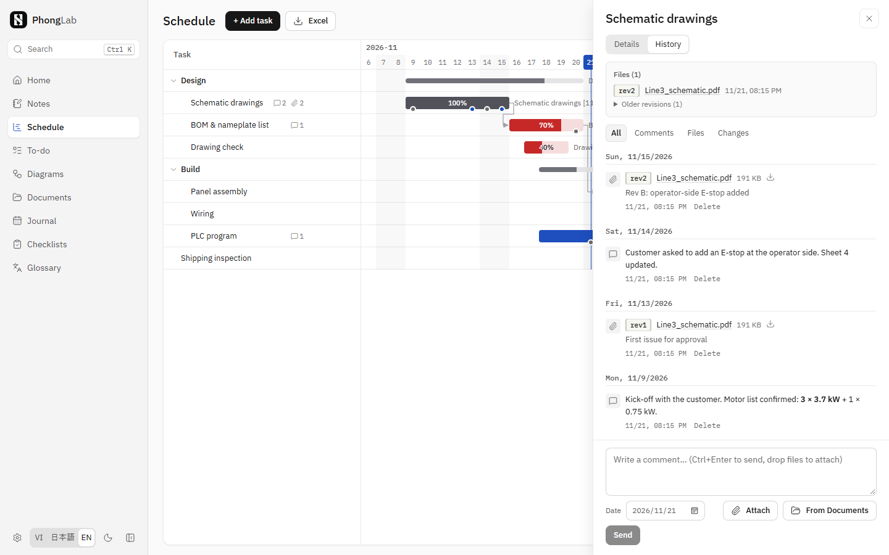
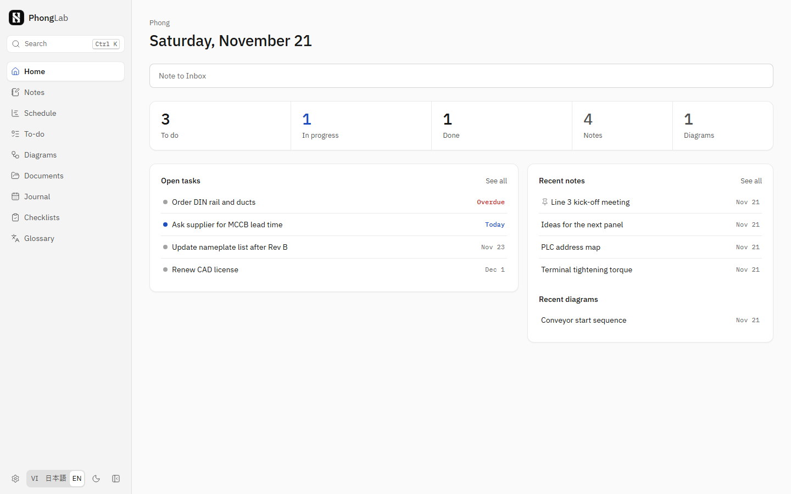
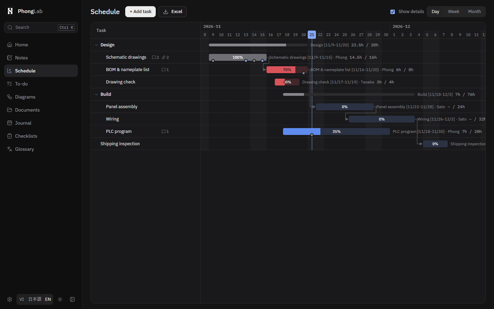
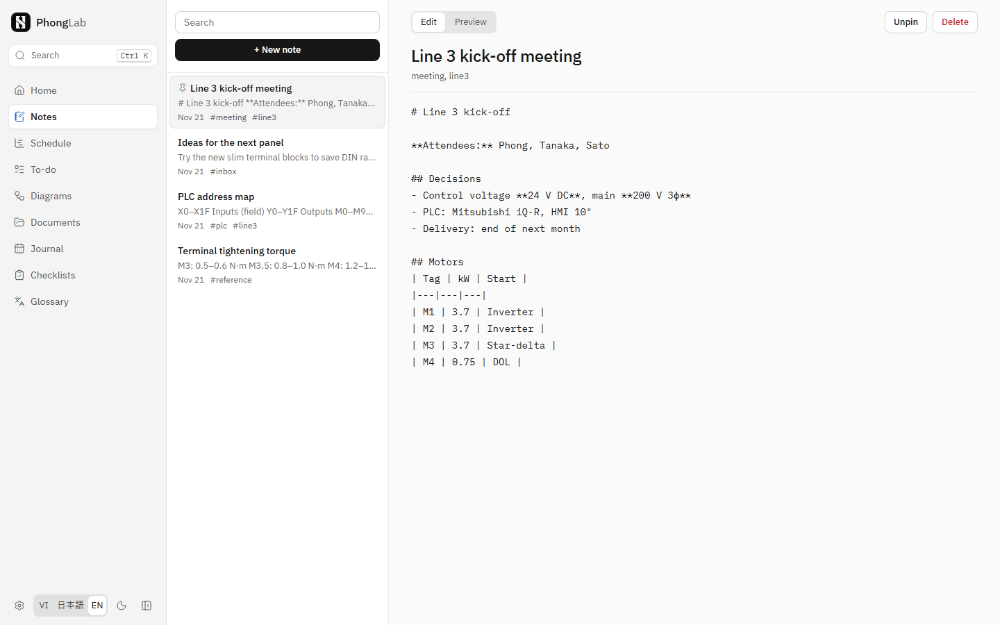
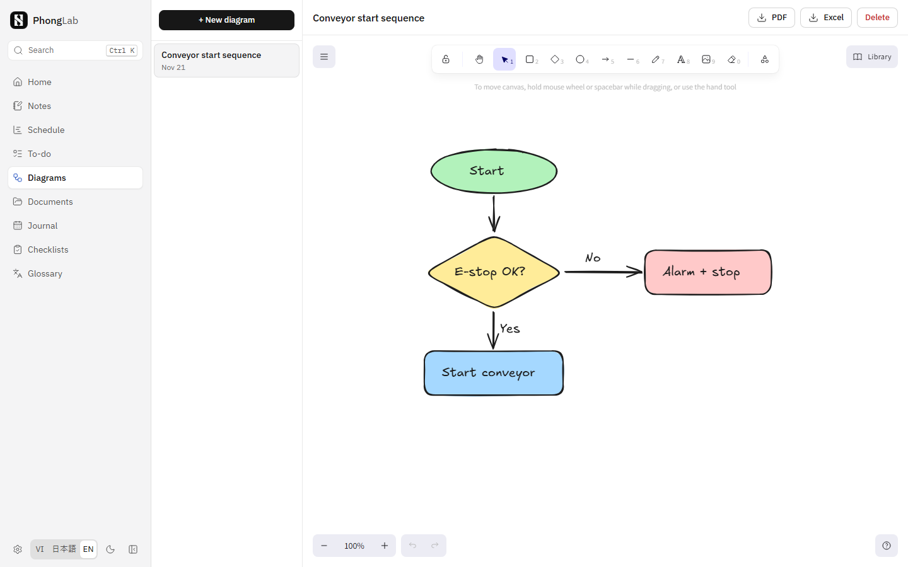
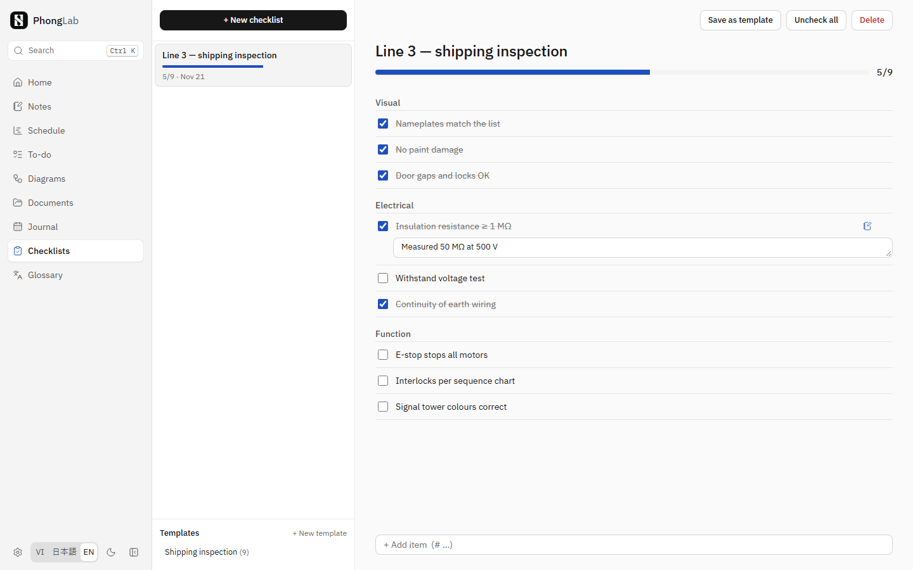
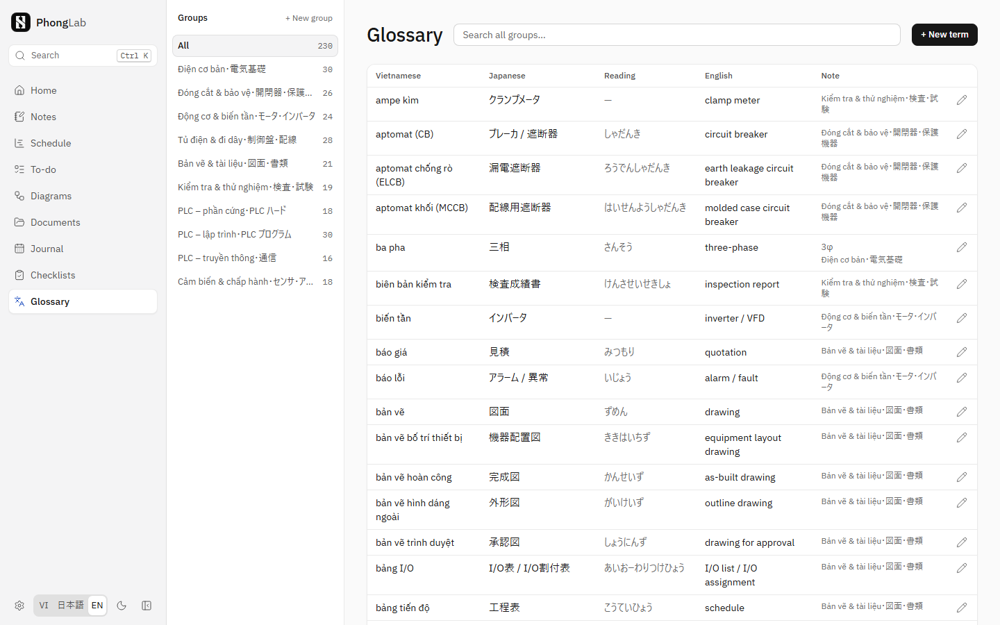
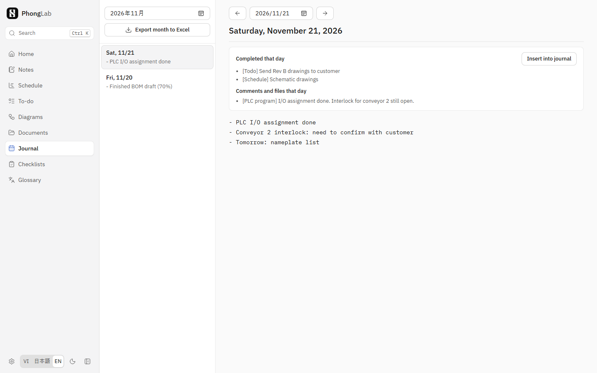

<p align="center"></p>

<h1 align="center">PhongLab</h1>

<p align="center">A self-hosted personal workspace that runs entirely on your own Cloudflare account.<br>
<a href="#tiếng-việt">Tiếng Việt</a> · <a href="#日本語">日本語</a></p>

<p align="center"></p>

---

## What's inside

| Tool | What it does |
|---|---|
| **Home** | Greeting, quick capture to an Inbox, open tasks, recent notes |
| **Notes** | Markdown notes with tags, pinning, search and auto-save |
| **Schedule (Gantt)** | Nested tasks, drag to move/resize, dependencies, planned/actual hours, per-task history with comments and versioned file attachments, Excel export (chart + change log) |
| **To-do** | Kanban board with projects and due dates |
| **Diagrams** | Excalidraw canvas, export to PDF (A4/A3) or Excel |
| **Documents** | File library with tags (stored in R2) |
| **Journal** | One page per day, pulls in what you finished and commented on, monthly Excel export |
| **Checklists** | Reusable templates with section headings, per-item notes and progress |
| **Glossary** | Grouped Vietnamese ⇄ Japanese ⇄ English terms, click to copy, accent-insensitive search |
| **Search** | `Ctrl+K` across everything |

The interface is available in Vietnamese, Japanese and English, with light and dark themes.

## Screenshots

<table>
  <tr>
    <td width="50%"><br><sub><b>Home</b>: quick capture, open tasks, recent notes</sub></td>
    <td width="50%"><br><sub><b>Schedule</b>: dependencies, progress, planned/actual hours, comment dots (dark theme)</sub></td>
  </tr>
  <tr>
    <td><br><sub><b>Notes</b>: Markdown with tags and pinning</sub></td>
    <td><br><sub><b>Diagrams</b>: Excalidraw, export to PDF (A4/A3) or Excel</sub></td>
  </tr>
  <tr>
    <td><br><sub><b>Checklists</b>: templates, sections, per-item notes</sub></td>
    <td><br><sub><b>Glossary</b>: grouped Vietnamese ⇄ Japanese ⇄ English terms</sub></td>
  </tr>
  <tr>
    <td colspan="2"><br><sub><b>Journal</b>: one page per day, pulls in what you finished</sub></td>
  </tr>
</table>

Screenshots use sample data from [`scripts/demo-data.mjs`](scripts/demo-data.mjs).

## How it runs

- **Cloudflare Workers** serves the app and its API ([Hono](https://hono.dev)).
- **D1** (SQLite) stores everything except files; **R2** stores uploads.
- **Cloudflare Access** protects the whole site (the API refuses any request without a valid Access token).

For one person this normally fits inside Cloudflare's free tiers. R2 needs a payment method on file even within its free allowance.

## Install

> Requires Node.js 20+ and a Cloudflare account.

```bash
git clone https://github.com/<you>/phonglab.git
cd phonglab
npm install
npx wrangler login
npm run deploy        # creates the D1 database and R2 bucket, deploys, applies migrations
```

Then protect the site with **Cloudflare Access** (next section). Until that is done the pages load but every API call is refused.

### Sign-in (Cloudflare Access)

1. In the Cloudflare **Zero Trust** dashboard, go to **Access → Applications → Add an application → Self-hosted**.
2. Use your site's hostname (your custom domain or the `*.workers.dev` address), and add a policy that allows only your email.
3. Copy the application's **AUD tag** and your **team domain** (`<team>.cloudflareaccess.com`).
4. Put them in `wrangler.jsonc` (or your `wrangler.mine.jsonc`) under `vars`, then deploy again.

### Optional: sample glossary

A starter set of ~230 electrical-engineering and PLC terms in 10 groups:

```bash
npm run seed:glossary
```

Re-running it never creates duplicates.

### Your own config (custom domain, fixed ids)

Copy `wrangler.jsonc` to `wrangler.mine.jsonc` (git-ignored), add your `database_id`, `routes` and Access values, then use:

```bash
npm run dev:mine      # local development against your config
npm run deploy:mine   # migrate + build + deploy your site
```

Site name, your name, default language and logo are set in the app under **Settings**, not in code, so updating to a new version never conflicts with your changes.

## Updating

```bash
git pull
npm install
npm run deploy        # or deploy:mine
```

Database migrations only ever add tables and columns, and run automatically on deploy. D1 also keeps 30 days of point-in-time recovery.

## Development

```bash
npm install
npm run dev           # http://localhost:5173, local D1 + R2, Access check off (see .dev.vars)
npm run typecheck
```

Create a `.dev.vars` file with `REQUIRE_ACCESS=false` for local development.

## License

[MIT](LICENSE)

The interface design pass follows [unslop](https://github.com/heydamir/unslop) by Damir Sokolovsky ([@heydamir](https://x.com/heydamir)), licensed under [CC BY 4.0](https://creativecommons.org/licenses/by/4.0/).

---

## Tiếng Việt

PhongLab là không gian làm việc cá nhân tự host, chạy hoàn toàn trên tài khoản Cloudflare của bạn: ghi chú, tiến độ dạng Gantt (lịch sử, bình luận, file có rev, xuất Excel), todo, sơ đồ, tài liệu, nhật ký, checklist, thuật ngữ Việt–Nhật–Anh, tìm kiếm `Ctrl+K`.

**Cài đặt:** làm theo phần *Install* ở trên (clone → `npm install` → `npx wrangler login` → `npm run deploy`), sau đó bật **Cloudflare Access** và điền team domain + AUD vào `vars`. Tên site, tên bạn, ngôn ngữ mặc định và logo chỉnh trong trang **Cài đặt**.

**Cập nhật:** `git pull` → `npm install` → `npm run deploy`.

## 日本語

PhongLab は自分の Cloudflare アカウント上で動くセルフホスト型の個人ワークスペースです。ノート、工程表（履歴・コメント・版管理付き添付・Excel 出力）、ToDo、フロー図、資料、日報、チェックリスト、用語集（越・日・英）、`Ctrl+K` 検索を備えています。

**導入：** 上記 *Install* の手順（clone → `npm install` → `npx wrangler login` → `npm run deploy`）のあと、**Cloudflare Access** を設定し、チームドメインと AUD を `vars` に記入してください。サイト名・名前・既定の言語・ロゴはアプリ内の **設定** で変更できます。

**更新：** `git pull` → `npm install` → `npm run deploy`
